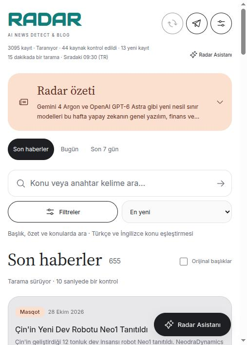
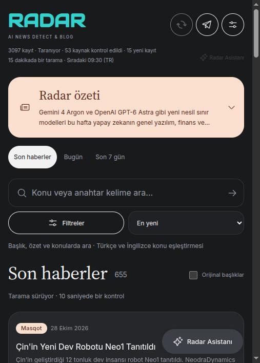
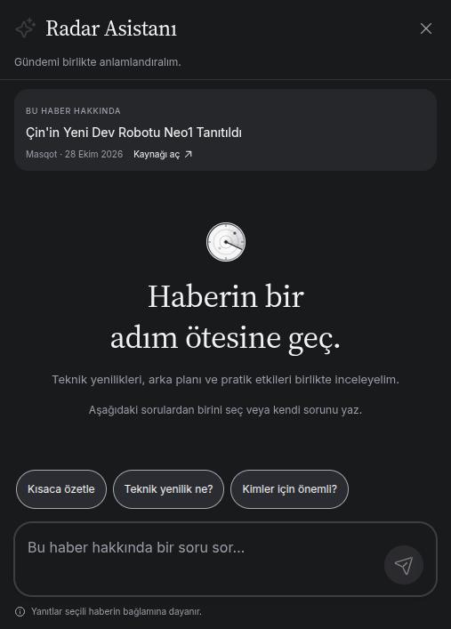
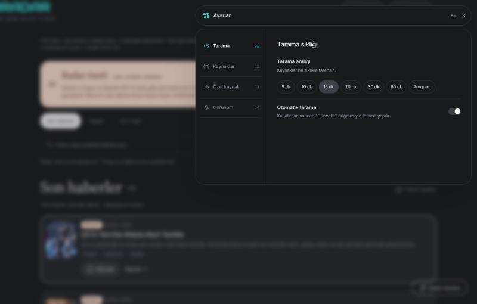

# AI News Radar

Yapay zekâ ve yakın teknoloji haberlerini kaynaklardan toplayan, sınıflandıran ve
haber bağlamında sohbet sunan uygulama. Python/FastAPI API, PostgreSQL veritabanı
ve Node/Express/EJS arayüzünden oluşur.

## Ekran görüntüleri

| Ana sayfa (açık tema) | Ana sayfa (koyu tema) |
| --- | --- |
|  |  |

| Radar Asistanı (haber bağlamında sohbet) | Ayarlar paneli |
| --- | --- |
|  |  |

## Öne çıkan özellikler

- **Otomatik haber taraması** — arXiv, Hugging Face, GitHub, Reddit, bloglar ve daha
  fazlası dahil onlarca kaynağı varsayılan olarak 15 dakikada bir tarar.
- **LLM ile sınıflandırma ve Türkçe çeviri** — her haberi teknik etki/hype/
  uygulanabilirlik eksenlerinde puanlar, sektör etiketler ve akıcı Türkçeye çevirir.
- **Haber bağlamında sohbet (Radar Asistanı)** — seçili haberin başlığı, özeti ve
  orijinal makale metnine dayanarak soru-cevap yapar.
- **Konu/anahtar kelime arama** — Türkçe ve İngilizce eşleşen terimlerle arama,
  sektör/kaynak/öncelik filtreleri.
- **Açık/koyu tema** — sistem tercihini izler, elle de değiştirilebilir.
- **Telegram bildirimleri** — yeni kabul edilen haberleri bir Telegram kanalına/
  gruba otomatik gönderir.
- **PWA desteği** — manifest + service worker ile yüklenebilir, statik arayüz
  varlıkları çevrimdışı da önbellekten sunulur.
- **Haftalık özet** — son 7 günün en öne çıkan gelişmelerini LLM ile özetler.

## Kurulum (Docker)

Veritabanı artık Docker'ın içinde değil, **uzak/yönetilen bir Postgres**'tir (örn.
[Neon](https://neon.tech), Supabase, Railway veya kendi sunucunuz) — böylece
uygulamayı hangi bilgisayarda ayağa kaldırırsanız kaldırın, aynı haber geçmişine
bağlanırsınız; veri tek bir makinenin diskine bağlı kalmaz.

```bash
cp .env.example .env
# DATABASE_URL'i kendi Postgres bağlantı string'inizle doldurun (bkz. .env.example
# içindeki not). ANTHROPIC_API_KEY değerini de doldurun.
# Mevcut .env dosyanız varsa üzerine yazmayın.
docker compose up -d --build
```

Arayüz: http://localhost:3000 · API: http://localhost:8008

Servisler: `api` (FastAPI), `scheduler` (otomatik tarama), `frontend` (Node/Express
arayüz). Hepsi `docker-compose.yml` içinde tanımlı, tek komutla ayağa kalkar.

Değişiklik sonrası yeniden derleme gerekir (imajlar volume mount kullanmaz):

```bash
docker compose up -d --build        # tüm servisler
docker compose up -d --build api    # sadece api (kod değişikliğinden sonra)
```

### İnternetsiz (offline) ortamda çalıştırma

**Build sırasında (`docker compose build`) internet gerekir:**

- Temel Docker imajları (`python:3.12-slim`, `node:22-alpine`) — Docker Hub'dan.
- `pip install -e .` — Python bağımlılıkları (sqlalchemy, anthropic, fastapi, requests,
  feedparser, beautifulsoup4 vb.) PyPI'dan.
- `npm install` — Node bağımlılıkları npm registry'den.

Bunlar yalnızca **ilk build'de** gerekir; imaj bir kez oluşunca `docker compose up`
tekrar internet istemeden yerel Docker önbelleğinden çalışır. Arayüz de Google Fonts
gibi bir CDN'e bağımlı değil — tüm fontlar (`frontend/public/fonts/`) imajın içinde
yerel olarak paketlenir.

**Çalışma zamanında (build bittikten sonra bile) internet gerekir:**

| Bölüm | Neden |
| --- | --- |
| Veritabanı (her şey) | `DATABASE_URL` uzak bir Postgres'e (örn. Neon) işaret ediyor — bir haberi **görüntülemek** bile internet ister. |
| Yeni haber taraması | RSS/Atom kaynakları (arXiv, GitHub, Reddit, bloglar...) dış sunuculardan çekiliyor. |
| LLM sınıflandırma/çeviri | Her yeni haberde `api.anthropic.com` çağrısı. |
| Radar Asistanı (sohbet) | Anthropic API + orijinal makale metnini kaynağın kendi URL'sinden çekme (`chat.py`). |
| Link önizleme | Habere tıklayınca OG metadata'yı kaynağın URL'sinden çeker (`link_preview.py`). |
| Telegram bildirimleri | `api.telegram.org` çağrısı. |

**İnternet gerektirmeyen (build sonrası tamamen yerel):** arayüzün statik dosyaları
(CSS, JS, fontlar, ikonlar) ve bunların PWA service worker önbelleği.

Özetle: veritabanı uzak olduğu için bu kurulumla **tamamen offline bir ortamda
uygulama hiç açılmaz** — en azından DB'ye ulaşmak şart. Tamamen offline/air-gapped
çalışması gereken bir demo için `DATABASE_URL`'i yerel bir Postgres'e (veya
`docker-compose.yml`'e eklenecek bir `postgres` servisine) yönlendirip veriyi
`pg_dump`/`pg_restore` ile o yerel veritabanına taşımanız gerekir — ama bu durumda
"her bilgisayardan aynı veriye eriş" özelliğinden vazgeçmiş olursunuz; ikisi
birbirini dışlar.

## Otomatik haber akışı

- Ayrı `scheduler` servisi, tarayıcı kapalıyken de varsayılan olarak **15 dakikada bir** kaynakları tarar. Eski sabit saat düzeni isteğe bağlıdır.
- Başlangıçta en son kaçırılmış zaman dilimini bir kez yakalar; bütün geçmiş
  saatleri peş peşe çalıştırmaz. Kalıcı tarama günlüğü yeniden başlatmada aynı
  tamamlanmış turu tekrarlamayı önler. Yarım kalan tur yeniden başlatılabilir.
- API, scheduler ve CLI aynı kilidi kullanır. Bir tarama çalışırken ikincisi
  başlamaz. Başarısız/kısmi kaynak durumları günlüğe kaydedilir; yeni haber
  bulunmayan başarılı kontrolün zamanı da kaybolmaz. Başarısız tamamlanan tur
  bir sonraki planlı saatte tekrar denenir; elle güncelleme de kullanılabilir.
- Ana sayfa **Son haberler / En yeni** ile açılır; yayın tarihi bugün olmasa da en son kayıtlar gösterilir.
  Bugün ve Son 7 gün isteğe bağlı tarih filtreleridir; gün sınırı Europe/Istanbul'dur. Yayın tarihi
  olmayan haberler alınma tarihine göre filtrelenir; yayın tarihi uydurulmaz.
  Atom kaynaklarında `updated` tarihi, `published` yoksa kullanılır.
- Açık sayfa **60 saniyede bir**, tarama sürerken **10 saniyede bir** kayıtları alır; sekme tekrar görünür olduğunda
  da kontrol eder. Gizli/çevrimdışı sekmeler istek göndermez. Kartlar tam sayfa
  yenilenmeden güncellenir; sohbet, taslak, filtre girdisi ve okuma konumu korunur.
- Sayfa GET istekleri kaynak taraması veya LLM özeti üretmez. Özet, tarama
  sırasında ihtiyaç olduğunda hazırlanır. Yeni haber olmadığı durumda eski
  içerik yeniymiş gibi sunulmaz.
- Telegram, aşağıdaki ayarlar açıldığında yeni haberleri kanal/grup kuyruğuna alır.
  Gönderici scheduler servisinde çalışır; e-posta gönderilmez.

Bu kurulumun çalışması için **bilgisayar/sunucu ve Docker açık olmalı**. Docker
kapatılırsa ya da bilgisayar uyursa tarama yapılamaz. Servisler Docker yeniden
başladığında `unless-stopped` politikasıyla açılır. Sürekli erişim için her zaman
açık bir sunucu gerekir; bu çalışma dış ortama yayın yapmaz.

`.env` üzerinden saatler değiştirilebilir:

```dotenv
AUTO_SCAN_ENABLED=true
SCAN_TIMEZONE=Europe/Istanbul
SCAN_INTERVAL_MINUTES=15
SCAN_HOURS=6,10,14,18,22
```

Varsayılan tarama aralığı 15 dakikadır. Eski saat düzeni için `SCAN_INTERVAL_MINUTES=0`; dört tur örneği: `SCAN_HOURS=6,12,18,22`. Değişiklikten sonra
`docker compose up -d api scheduler` çalıştırın. API ve scheduler aynı ayarları
alır. Kontrol: `docker compose ps`, `docker compose logs --tail=30 scheduler`,
`GET /api/scan-status`. İki dakikadan eski scheduler heartbeat'i arayüzde
bağlantı bekleniyor olarak görünür. Tarama günlüğü `scan_runs` tablosundadır;
`new_count` yalnızca commit edilmiş yeni gelişmeleri sayar.

## Yerel geliştirme

```bash
python3 -m venv .venv
.venv/bin/pip install -e '.[dev]'
npm --prefix frontend install
.venv/bin/uvicorn ai_news_radar.web.app:app --reload --port 8008
npm --prefix frontend run dev
# Otomatik tarama için ayrı terminal:
.venv/bin/python -m ai_news_radar.scheduler
```

Docker scheduler zaten çalışıyorsa geliştirmede ikinci bir scheduler gerekmez.
PostgreSQL advisory lock veya dosya tabanlı SQLite kilidi çakışmayı engeller.
Bellek içi SQLite yalnızca aynı süreç içindeki testler içindir.

## Test

```bash
DATABASE_URL=sqlite:// .venv/bin/python -m pytest -q
npm --prefix frontend test
```

Testler kaynak/LLM erişimlerini yerel fixture'larla değiştirir. Tarama takvimi,
tekrar engelleme, eşzamanlılık, hata/rollback, İstanbul gün sınırı, salt okunur
feed, canlı DOM birleştirme, sohbet taslağı ve klavye odağı kapsanır.

## Kaynak doğrulama sınırı

Akademik/şirket kaynakları mevcut kaynak politikasıyla kabul edilir. Sosyal medya
ve savunma kaynaklarının çapraz doğrulaması henüz tamamlanmadığından bunlar
`pending_cross_verification` olarak kalır. Arayüz kaynak kabulünü bağımsız
haber teyidi olarak sunmaz.

### Konu üzerinden arama

Arama kutusu Türkçe ve orijinal başlık/özetleri, sektör etiketlerini ve kaynak adını tarar. `bilgisayarlı görü`, `computer vision` ve `görüntü işleme` gibi tanımlı konu karşılıkları ilgili teknik terimlerle genişletilir. Türkçe karakter kullanmadan da arama yapılabilir (`bilgisayarli goru`). Birden fazla kavram birlikte aranır: `bilgisayarlı görü sağlık` iki kavramla da eşleşen haberleri getirir.

Önerilen sıralama, arama varken ilgi düzeyini; boş aramada yayın tarihini kullanır. Tarih, kaynak, sektör, öncelik ve teyit filtreleri korunur. Seçili tarihte sonuç bulunmazsa aynı diğer filtrelerle arşivdeki eşleşme sayısı ve aramayı koruyan bağlantı gösterilir.

Bu özellik mevcut kayıtlar üzerinde çalışan bir konu sözlüğü ve metin aramasıdır; sınırsız anlamsal arama, serbest soru yanıtlama veya yazım hatası düzeltme değildir. Yeni konu karşılıkları `src/ai_news_radar/search.py` içindeki `TOPICS` sözlüğüne eklenebilir. Arşiv büyüdüğünde arama indeksine geçiş değerlendirilmelidir. Radar Asistanı halen seçili haberin bağlamında yanıt verir.


## Telegram kanal/grup akışı

Yeni kabul edilmiş haberler kısa Türkçe başlık, en fazla iki cümle/320 karakter özet, kaynak/yayın tarihi ve orijinal bağlantıyla gönderilir. Çeviri yoksa kaynak metni kullanılır. Büyük bağlantı önizlemeleri kapalıdır; mesajlar sessiz gönderilir. Puan tablosu gönderilmez.

📣 Haberleri telefonundan takip etmek için Telegram kanalımıza katılabilirsin: **[t.me/+PLz5p6UnqV03NmFk](https://t.me/+PLz5p6UnqV03NmFk)**

Etkinleştirmeden önceki arşiv otomatik gönderilmez. API, scheduler veya CLI'nin işlediği **yeni**, kaynak politikasıyla kabul edilmiş haberler kaynak kaydıyla aynı transaction'da `telegram_deliveries` tablosuna yazılır. Tarama veya uygulama yeniden başlatıldığında `sent` kayıtlar tekrar gönderilmez. Hedef değişince eski hedefin kuyruğu yeni hedefe aktarılmaz. Etkinleştirmeden sonra ilk yeni haber bir sonraki taramada kuyruğa girer; her scheduler döngüsünde en fazla bir mesaj gönderilir (normalde 30 saniyede bir). Tarama sürerken gönderim bekler. Haber taraması kapatılsa bile (`AUTO_SCAN_ENABLED=false`) scheduler servisi açıksa mevcut Telegram kuyruğu işlenir.

Telegram açıkça hız limiti bildirirse `retry_after` kadar, geçici sunucu reddinde en az beş dakika beklenir. Yetki/hedef hatası `failed` olarak kaydedilir. Ağ zaman aşımı, geçersiz yanıt veya gönderim sırasında kapanma durumunda mesajın ulaşıp ulaşmadığı bilinemez: kayıt `unknown` kalır ve otomatik tekrar gönderilmez. Durum komutunda `failed`/`unknown` varsa kanalı ve ayarları kontrol etmek gerekir; yeniden gönderme kararı alıcının akışıyla karşılaştırılarak verilmelidir. Bu, Telegram'ın idempotency anahtarı sunmaması nedeniyle bilinçli bir tercihtir; mutlak tek-sefer teslim garantisi yoktur.

Gönderimi durdurmak için `TELEGRAM_ENABLED=false` yapıp API ve scheduler'ı yeniden oluşturun. Kalıcı kuyruk korunur. Bot sırları hata günlüklerine yazılmaz. Resmî belgeler: [sendMessage](https://core.telegram.org/bots/api#sendmessage), [gönderim sınırları](https://core.telegram.org/bots/faq#my-bot-is-hitting-limits-how-do-i-avoid-this).


### Son kaynaklar ve elle güncelleme

Hugging Face Blog RSS beslemesi ve `https://substack.com/topics/ai` sayfasının herkese açık yazı metaverileri taranır. Substack konu sayfası bir kürasyon listesidir; tüm Substack AI yayınlarını kapsadığı iddia edilmez. En yeni 15 yazı gerçek yayın tarihine göre alınır, ücretli içerik açılmaz. Sayfa şeması değişirse sessiz başarı yerine kaynak hatası kaydedilir.

`POST /api/refresh` ortak kilidi alan tarama işçisi başladıktan sonra **202** ve tarama kimliğini döner; meşgulse **409**. Arayüz “Güncelle” sırasında sayfa değiştirmez, filtre ve sohbet taslağını korur. Taramanın bitişi `scan-status` ile izlenir. Sürecin kapanması durumunda sonraki tarama eski `running` kaydını `interrupted` yapar.

## Otomasyon ve yerel AI kaynakları

Her taramada kontrol edilen ek kaynaklar:

- n8n Blog, Make Blog, Zapier Blog, The Rundown AI
- Medium: `artificial-intelligence`, `automation`, `yapay-zeka`, `otomasyon` etiketleri
- Doğuş Teknoloji'nin kurumsal blogu ve Medium yayını, Atalay Tech'in resmi blogu
- Reddit r/LocalLLaMA, Ollama Blog, LM Studio Blog
- Civitai Education, Stable Diffusion Art, OpenZeka, Masqot
- Hugging Face Blog ve Ben’s Bites mevcut kaynaklarıyla korunur; ikinci kez eklenmez.

Bu grupta **son 96 saat** içindeki tarihli yayınlar, en yeni önce olacak şekilde alınır.
Bu sürede yazı yoksa kaynağın en son tarihli **bir** yazısı alınır; gerçek eski yayın tarihi korunur.
Gelecek tarihli/tarihsiz kayıtlar bu pencereye dahil edilmez. Kaynak başına turda en fazla 50,
Reddit'te 100 yazı değerlendirilir. Medium etiketlerindeki aynı URL'ler birleştirilir.
Aynı kaynaktaki daha önce kaydedilmiş içerikler yeniden eklenmez.

RSS/Atom beslemesinin sunduğu kayıt sayısı sınırlıdır: özellikle Medium etiketleri son 10'ar
kaydı, Reddit en fazla 100 kaydı sunar. **Dört günlük arşivin eksiksiz tarandığı garanti edilmez.**
15 dakikalık düzen yeni yazıların zaman içinde yakalanmasını sağlar; uzun kesintilerde kayıplar olabilir.
Civitai için resmi **Education** yayınları izlenir, model/görsel galerisinin tamamı taranmaz.
Atalay Tech için doğrulanan resmi blog kullanılır; doğrulanmamış bir Medium hesabı eklenmez.

Make'in güncel `/blog` sayfasındaki en fazla 20 yazının JSON-LD verisi okunur. Atalay Tech'in
blog listesindeki JSON-LD ve Doğuş'un görünür blog kartları ayrıştırılır. Bu sayfaların yapısı
değişirse hata tarama günlüğünde görünür; erişim engeli veya HTML hata sayfası başarılı boş
RSS taraması sayılmaz. Genel Medium ve Reddit kayıtları sosyal kaynak olarak
`pending_cross_verification` durumunda tutulur; arayüzde **Teyit bekleyenleri göster** ile açılır.

Kaynak tanımları: `src/ai_news_radar/ingestion/__init__.py`.
